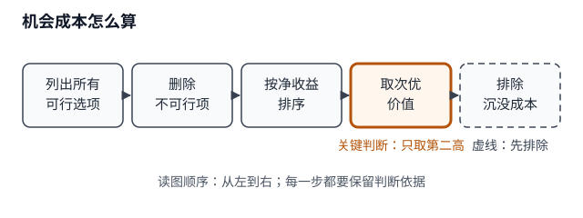

# 第 2 节 · 机会成本（L1 读者版样板）

- 状态：草稿（读者版样板）
- 本节目标：学完能独立判断一个选择的机会成本，并排除不可行选项与沉没成本。
- 前置：会比较几个选项的净收益（净收益 = 已扣除所有显性成本后的净值）；知道“做选择”意味着放弃其他选项。
- 预计：约 20 分钟

## 本节速览

| 要解决的问题 | 一句话结论 | 用在哪 |
|---|---|---|
| 选了一个选项，机会成本是多少？ | 取可行选项中的次优价值，不求和、不算沉没成本。 | 判断取舍、解释“为什么不是所有没选的总和”。 |
| 已经花掉的钱要不要算？ | 沉没成本不计入；只看当前选择的次优用途。 | 排除“已经投入所以继续”的误区。 |

## 概念 1 · 机会成本【本节最小必需】

- 一句话结论：机会成本是放弃的可行选项中次优选择的价值。
- 定义：机会成本是做出一个选择时，放弃的**可行选项中次优选择**的价值；不是所有未选项之和，也不包括已经发生、无法收回的沉没成本。

- 图注：机会成本只看可行选项中的次优价值；不可行项和沉没成本先排除（流程示意）。

- ① 题目：小王周末有三个可行选择：兼职净收益 300 元、参加培训净收益 200 元、在家休息净收益 100 元。他选择参加培训。培训的机会成本是多少？
- ② 解析：先删掉不可行选项；再把可行选项按净收益排序；机会成本只取“没选的那个最好的”的价值。兼职 300 元是次优选择，休息 100 元不是；所以机会成本是 300 元。
- ③ 答案：

> 答：结论：选择培训的机会成本是 300 元。
>
> 依据：机会成本等于放弃的可行选项中次优选择的价值；兼职 300 元高于休息 100 元，故次优是兼职。
>
> 适用：本题假设三项都可行、净收益已扣显性成本且无其他成本；若兼职不可行，答案会变。

- 配对自测：小李周末的可行选择：兼职净收益 400 元、课程净收益 250 元、休息净收益 100 元。他选择课程。课程的机会成本是多少？（先自己作答，答案见本节自测答案）
- ④ 易错：把所有未选项（包括不可行的）相加，或把已经花掉的钱算进去（如票钱 200 元已花，继续看的机会成本不是 200 元，而是这段时间次优用途的价值）。原因：机会成本只看可行选项里的次优选择，沉没成本不因当前选择改变。补救：先删不可行项，再排序净收益，只取第二高。
- ⑤ 小结：机会成本 = 可行选项中次优选择的价值；不是所有未选项之和；沉没成本不计入。
- 闭卷自检：合上讲义，用 3 句话解释机会成本；给自己 0–100% 把握；对照 ⑤ 补漏；再完成下面的迁移自测。

## 本节自测

- 迁移自测：某公司已经投入 5 万元研发（不可收回）。现在它要在 A 项目（净收益 8 万元）和 B 项目（净收益 6 万元）之间选择，最终选择 A。选择 A 的机会成本是多少？已经投入的 5 万元要不要算进去？为什么？

## 本节自测答案

- 配对自测：400 元。次优选择是兼职 400 元；课程 250 元、休息 100 元不是机会成本。
- 迁移自测：机会成本是 6 万元，即放弃的 B 项目净收益；5 万元是沉没成本，无论选 A 还是选 B 都已经发生，不计入。常见错答：把 5 万和 6 万相加得 11 万，或把 A 的 8 万当成机会成本。

## 回看索引

- 核心一句话：机会成本 = 可行选项中次优选择的价值。
- 最容易错：把不可行选项或沉没成本算进去。
- 下一步：做本节自测的迁移题，再回看 ④ 的“票钱”反例。
