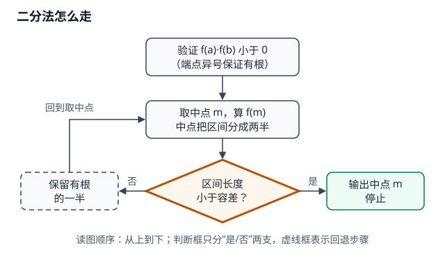

# 第 3 节 · 二分法求近似根（L1 程序型样板）

- 状态：草稿（读者版样板）
- 本节目标：学完能按二分法步骤独立求一个连续函数的近似根，并说清停止条件。
- 前置：会算函数值、会判断两个数是否异号；知道区间端点的含义。
- 预计：约 20 分钟

## 本节速览

| 要解决的问题 | 一句话结论 | 用在哪 |
|---|---|---|
| 方程有根但解不出来，怎么近似？ | 每次取中点，保留符号相反的一半，直到区间足够小。 | 求近似根、确认根所在范围。 |
| 什么时候可以停？ | 区间长度小于给定容差就停，输出中点。 | 控制精度与迭代次数。 |

## 概念 1 · 二分法求近似根【本节最小必需】

- 一句话结论：二分法用“取中点、看符号、留一半”把根所在区间不断缩小。
- 定义/条件：f(x) 在 [a,b] 上连续，且 f(a)·f(b) 小于 0（异号足以保证区间内有根）；每轮取中点 m，按 f(m) 与端点的符号关系保留有根的一半。

- 图注：每轮只保留有根的一半；区间长度小于容差时输出中点（流程示意）。

- ① 题目：用二分法求 f(x)=x^2−2 在区间 [1,2] 内的一个近似根，容差 0.2。
- ② 解析：先验证 f(1) 与 f(2) 异号；每轮取中点、算函数值、按符号保留一半；区间长度小于 0.2 时停止，输出中点。
- ③ 答案：

> 步骤：先验证端点异号，再按循环取中点。
>
> ① 算 f(1)=−1、f(2)=2，异号，根在 [1,2]。
>
> ② 取中点 1.5，f(1.5)=0.25 大于 0，保留 [1,1.5]。
>
> ③ 取中点 1.25，f(1.25)=−0.4375 小于 0，保留 [1.25,1.5]。
>
> ④ 取中点 1.375，f(1.375)=−0.109 小于 0，保留 [1.375,1.5]。
>
> 输出：区间长度 0.125 小于 0.2，近似根取 1.44。

- 配对自测：用二分法求 f(x)=x^3−2 在 [1,2] 内的近似根，容差 0.2；写出前两轮保留的区间。
- ④ 易错：不验证端点异号就直接二分；按 f(m) 的符号保留错半边；把容差当成端点差；最后输出区间端点而不是中点。原因：二分法依赖“异号区间内有根”，每一步只保留仍然异号的一半；容差是区间长度上限。补救：每轮先写区间与端点符号，再取中点；最后检查区间长度与输出中点。
- ⑤ 小结：先验端点异号；取中点看符号；保留有根的一半；区间小于容差停，输出中点。
- 闭卷自检：合上讲义，用 3 句话说出二分法的循环与停止条件；给自己 0–100% 把握；对照 ⑤ 补漏；再完成下面的迁移自测。

## 本节自测

- 迁移自测：判断“若 f(a)·f(b) 大于 0，能否直接用二分法？”并举一个反例说明。

## 本节自测答案

- 配对自测：第一轮中点 1.5，f(1.5)=1.375 大于 0，保留 [1,1.5]；第二轮中点 1.25，f(1.25)=−0.047 小于 0，保留 [1.25,1.5]。
- 迁移自测：不能直接断定有根。反例：f(x)=x^2−1 在 [−2,2] 上，f(−2)=3、f(2)=3 同号，但区间内有两个根；需先找到异号子区间，或改用其他方法。常见错答：把“同号”当成“一定无根”。

## 回看索引

- 核心一句话：二分法每轮保留有根的一半，直到区间长度小于容差。
- 最容易错：不验异号、符号判断反了、输出端点而不是中点。
- 下一步：重做配对自测的两轮区间，再用一个一次函数验证符号判断。
